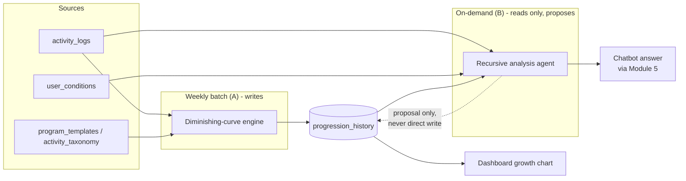

# RLM Flowcharts

Companion to [documentation_AGENT_RLM.md](documentation_AGENT_RLM.md) and
[Implementation_RLM_plan.md](Implementation_RLM_plan.md). Rendered as Mermaid — GitHub
and most Markdown previewers (including VS Code with the Mermaid extension) render these
inline.

---

## A. Weekly Diminishing-Curve Progression (extends Module 15)

```mermaid
flowchart TD
    A[Scheduled batch job<br/>low-priority queue, 8.4] --> B{For each active<br/>program entry}
    B --> C[Compute adherence over window<br/>from activity_logs, 15.2]
    C --> D{Excluded?<br/>suspended / calibrating /<br/>user_override / custom exercise}
    D -- yes --> Z1[Skip entry]
    D -- no --> E{Open discomfort<br/>episode?}
    E -- yes --> Z2[Hold. Never increase.<br/>15.3]
    E -- no --> F{Adherence bucket}
    F -- "< 50%" --> G[Reduce target<br/>14.6d formula/floor]
    F -- "50-79%" --> H[Hold - no change]
    F -- ">= 80%" --> I[Compute diminishing-curve %<br/>capacity(week)/capacity(week-1) - 1]
    I --> J[Clamp:<br/>min(curve_pct, per-adjustment cap 15.4,<br/>3x band ceiling 14.5)]
    J --> K{Result below<br/>floor 0.5x baseline?}
    K -- yes --> L[Hold at floor<br/>15.4]
    K -- no --> M[Apply new target<br/>write progression_history<br/>old_target, new_target, curve_pct,<br/>adherence_pct, reason]
    G --> M
    M --> N[Dashboard growth chart<br/>reads progression_history]
```

---

## B. On-Demand Recursive Analysis (extends Module 16 + Module 5 RAG)

```mermaid
flowchart TD
    A[User asks chatbot:<br/>any question] --> B0{Classify question<br/>existing topic router, Module 5}
    B0 -- "not performance-related<br/>e.g. 'what helps frozen shoulder pain'" --> R1[Existing Module 5 flow, unchanged:<br/>retrieve medical chunks only]
    R1 --> R2[Single LLM call:<br/>retrieved chunks + chat history<br/>-> natural-language answer]
    R2 --> R3[Answer returned to user<br/>RLM never invoked]

    B0 -- "performance / growth question<br/>e.g. 'how am I doing', 'can I do more'" --> B[Module 16 Program Agent<br/>invokes RLM]
    B --> C[Decompose into sub-checks<br/>max 6 per question]
    C --> C1[Adherence trend]
    C --> C2[Plateau detection]
    C --> C3[Streak / consistency]
    C --> C4[Discomfort history on entry]
    C --> C5[Compare vs weekly-batch curve]

    C1 & C2 & C3 & C4 & C5 --> D{Any sub-check<br/>flags a finding?}
    D -- "yes, e.g. plateau" --> E[Recurse one level deeper<br/>max depth 2<br/>e.g. re-check over 8 weeks not 4]
    D -- no --> F[Structured findings JSON<br/>summary_signal + findings[]]
    E --> F

    F --> G{Findings support<br/>an escalation proposal?}
    G -- yes --> H[Compute proposed_pct_increase<br/>clamp at 1.5x escalation guard<br/>+ existing 15.4 / 14.5 guards]
    G -- no --> I[escalation_proposal.eligible = false]
    H --> J[condition_gate: read cached<br/>safety-grid result, 14.4]
    I --> J

    J --> K[Findings JSON handed to<br/>Module 5 _retrieve_and_answer<br/>as EXTRA context, same call as R1/R2]
    K --> L[Retrieve medical chunks<br/>for user's conditions<br/>Verified Medical Vector DB]
    L --> M[Single LLM call:<br/>findings + retrieved chunks + chat history<br/>-> natural-language answer]
    M --> N{Answer implies<br/>a program change?}
    N -- yes --> O[Propose only - 16.1<br/>"Add this to your dashboard?"<br/>explicit confirmation required, 16.5]
    N -- no --> P[Answer returned to user<br/>no write occurred]
    O --> Q{User confirms?}
    Q -- yes --> R[Write via Module 14<br/>hard gate re-applied at write time, 14.3/16.3]
    Q -- no --> P
    R --> S[progression_history updated<br/>same table as flow A]
```

---

## C. Shared data flow (why both cadences agree with each other)



**Read this diagram as the core safety property of the whole design:** only box `WB`
(the deterministic weekly engine) has a write arrow into `progression_history`. `RA`
(the recursive/RLM agent) only reads it and the raw logs, and its only path back to
that table is through the user-confirmed, hard-gated write flow in diagram B — the
dotted line, never a direct arrow.
