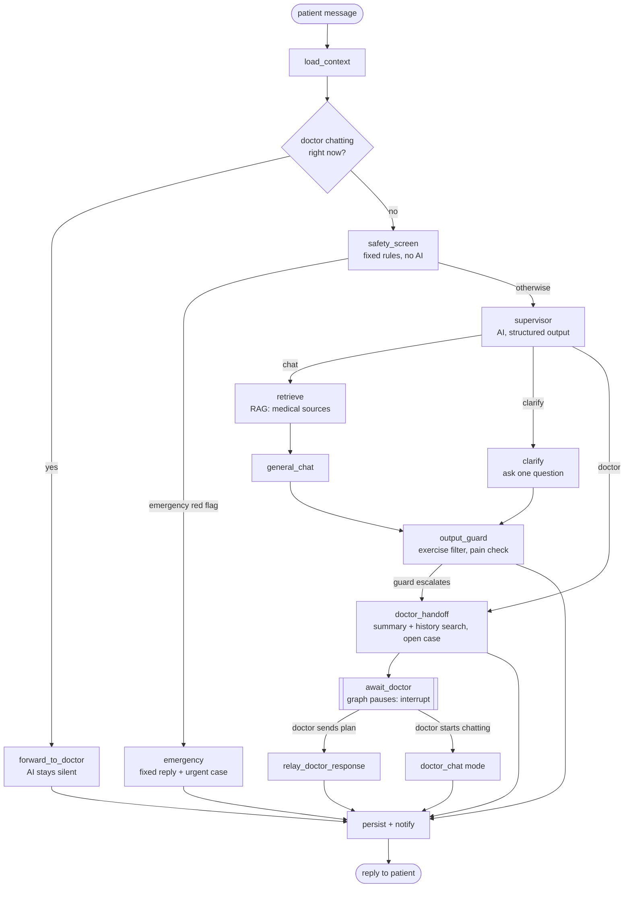

# Medical agent on LangGraph: architecture plan

Status: **design agreed (Phase 0 done), nothing built yet.** Each phase in
section 11 starts only after approval.

## 1. Goal

Move the agent from one hand-written function (`triage.handle_message`) to a
LangGraph graph with a **supervisor**:

1. Every patient message goes first to the **supervisor**. It looks at two things:
   - the **patient's condition**: profile, conditions, weekly progress, pain trend, open case, doctor plan
   - the **current request**: what they're asking or describing right now
2. **Hard condition or hard request**: hand over to a **doctor**. The doctor gets
   the request, the patient's conditions and context, and a summary of all
   their chats. The doctor answers with a plan, by chatting with the patient,
   or both. The agent passes the doctor's response on and follows it.
3. **Normal condition and normal request**: the patient talks to the **general
   AI**, which answers from trusted medical sources (RAG).

## 2. Decisions

| Question | Decision |
| --- | --- |
| The two mixed cases (section 4) | **Confirmed:** normal condition + hard request → doctor; hard condition + normal request → general AI, restricted |
| Conversation thread | **One continuous thread per patient.** Doctor cases live inside it |
| What the doctor sees | The patient's request, profile, conditions, weekly progress, the agent's reason for escalating, and an **AI summary of all the patient's chats** (plus relevant past messages found by search) |
| Notifications | **Yes, both ways.** Patient: when the doctor replies or sends a plan. Doctor: on new cases; emergencies immediately |
| How the doctor responds | **Doctor's choice:** send a formal plan, chat back and forth with the patient, or both |
| RAG | **Yes.** Start with grounding the general AI in medical sources and searching the patient's own chat history; supervisor guideline lookup later |

## 3. Where things are today

`backend/app/agent/`:

| File | Today | In the graph |
| --- | --- | --- |
| `context.py` | Builds the patient context | Reused as the `load_context` node |
| `red_flags.py` | Fixed emergency/priority rules | Reused as the `safety_screen` node |
| `prompts.py` | One prompt that both decides and replies | Split into supervisor, chat, clarify, handoff, relay prompts |
| `llm.py` | OpenRouter JSON client | Replaced by a LangChain chat model on OpenRouter (see 9) |
| `triage.py` | The whole turn in one function | Replaced by `graph/` |

Doctor side: `routers/doctor.py` (case queue, plan submission). Chat endpoint:
`POST /chat` in `routers/patient.py`.

## 4. The supervisor's decision

| | Normal request | Hard request |
| --- | --- | --- |
| **Normal condition** | **General AI** | **Doctor** |
| **Hard condition** | **General AI, restricted** | **Doctor** |

- **Normal condition, hard request → doctor.** A healthy person describing
  numbness or weeks of worsening pain still needs a doctor.
- **Hard condition, normal request → general AI, restricted.** A heart patient
  asking "how do I log my walk" or "what does BMI mean" shouldn't wait for a
  doctor. The AI may not suggest new exercises, follows the doctor's plan if
  there is one, and anything about exercise or symptoms goes to the doctor.
- **Emergencies bypass the supervisor**: fixed rules, instant reply, no AI.

**What counts as "hard":**

- Condition: any `refer` condition (heart, pregnancy, recent surgery,
  uncontrolled sugar/BP, ...), pain >= 8 this week, pain rising by 2+ vs last
  week, an open case still waiting for the doctor.
- Request: new or worsening symptoms, pain >= 7, numbness/tingling, swelling,
  fever, medicine questions, asking to start something strenuous, priority red
  flags.

## 5. The graph



### Nodes

| Node | AI? | Job |
| --- | --- | --- |
| `load_context` | No | Profile, conditions, approved exercises, this week vs last week, memory, open case, doctor plan, last 20 messages, whether a doctor is chatting |
| `forward_to_doctor` | No | A doctor is in live chat with this patient: deliver the message to the doctor, AI does not reply |
| `safety_screen` | No | Red-flag scan of the message. Computes the **hard-rule floor**: refer condition, pain >= 8 this week, pain rising, priority red flags |
| `supervisor` | Yes | Rates **condition severity** and **request severity** (normal / hard), picks a route, writes a short reason. Structured output only |
| `retrieve` | Embeddings | RAG: finds relevant passages from the medical sources for the patient's conditions |
| `general_chat` | Yes | Answers from the retrieved passages, cites them, suggests exercises from the approved list only, follows any doctor plan |
| `clarify` | Yes | When the supervisor can't judge yet: asks one question (where, since when, pain 0-10) |
| `doctor_handoff` | Yes | Summarises **all** the patient's chats, searches their history for relevant past messages, opens or updates the case, notifies the doctor, tells the patient a doctor will reply |
| `await_doctor` | No | **Pauses the graph** with LangGraph `interrupt()` until the doctor responds |
| `relay_doctor_response` | Yes | Turns the doctor's plan into a clear message for the patient |
| `doctor_chat` mode | No | The doctor chose to chat: messages go straight between doctor and patient until the doctor ends the chat |
| `emergency` | No | Fixed 112/108 (or Tele-MANAS 14416) message, urgent case, immediate doctor notification. Never waits for the AI |
| `output_guard` | No | Drops unapproved exercises, forces a doctor if the patient states pain >= 7, can send the turn back to `doctor_handoff` |
| `persist + notify` | No | Saves messages, memory notes, case updates in one transaction; sends notifications |

### State (what flows between nodes)

```python
class AgentState(TypedDict):
    user_id: str
    message: str
    context: dict                 # from load_context
    history: list[dict]           # last 20 messages
    red_flags: list[str]          # from safety_screen
    forced_reasons: list[str]     # hard rules that require a doctor
    condition_severity: Literal["normal", "hard"]
    request_severity: Literal["normal", "hard", "emergency"]
    route: Literal["chat", "clarify", "doctor", "emergency", "doctor_live"]
    sources: list[dict]           # RAG passages used for the reply
    reply: str
    exercises: list[dict]
    case_id: str | None
    doctor_response: dict | None  # plan or chat, filled when the graph resumes
    new_facts: list[str]
```

## 6. Rules the AI can never override

These stay as code, outside the AI:

1. **Fixed rules come first.** `safety_screen` runs before the supervisor. If a
   hard rule says doctor, the supervisor can't route to chat. It may escalate,
   never de-escalate.
2. **Emergencies never touch the AI.**
3. **Exercises only from the safety grid** for all the patient's conditions;
   `output_guard` enforces it even if the AI or a retrieved passage suggests otherwise.
4. **The doctor beats the AI.** Once a plan exists, `general_chat` follows it.
   While a doctor is chatting, the AI doesn't answer at all.
5. **RAG informs, it never decides.** Retrieved text can't add an exercise,
   override a doctor, or downgrade a hard request.
6. **AI fails → safe fallback.** If the supervisor call fails and a hard rule
   applies, go to the doctor anyway; otherwise tell the patient to try again.

## 7. The doctor flow

**One thread per patient.** LangGraph's checkpointer stores the graph's state
in Postgres (our Supabase database) under thread id = patient id. Each doctor
case is an episode inside that thread; the case id is kept in state.

1. **Hand-off.** `doctor_handoff` writes a case with: the current request, the
   escalation reason, profile, conditions, weekly progress, and an AI summary
   of all the patient's chats, plus the most relevant past messages from a
   history search (section 8). The doctor is notified.
2. **Pause.** `await_doctor` calls `interrupt()`. The graph stops; its state stays
   saved. If the patient keeps chatting meanwhile, the supervisor sees the open
   case and answers within limits ("your doctor is reviewing this; meanwhile, rest").
3. **Doctor responds**, in either or both ways:
   - **Plan:** `POST /doctor/cases/{id}/plan` resumes the thread with
     `Command(resume=plan)`. `relay_doctor_response` explains it to the patient,
     and the AI follows it from then on.
   - **Chat:** the doctor opens a live chat. The patient's messages go to the
     doctor (`forward_to_doctor`) and the AI stays silent until the doctor ends
     the chat, optionally finishing with a plan.
4. **Patient notified** of every doctor reply.

**Notifications.** First version: in-app (badge, and the doctor queue already
refreshes) plus email. Push and SMS later, using a `device_push_tokens` table
like the main app's. Emergencies notify the doctor immediately.

## 8. RAG

| Use | Phase | Source | Notes |
| --- | --- | --- | --- |
| **1. Grounding `general_chat`** | 5 | ~834 chunks from NHS, NICE, AAOS, WHO, ICMR, MedQuAD (main app's `rag_chunks`, pgvector, `text-embedding-3-small`) | Scoped to the patient's conditions + general activity guidance. Sources shown to the patient |
| **2. Patient history search** | 5 | Embeddings of this patient's own messages | For the doctor summary and long conversations |
| 3. Supervisor guideline lookup | later | "When to see a doctor" sections of the same sources | Only after measuring the supervisor alone |
| 4. Exercise instructions | later | Exercise table (instructions, video) | A lookup, not true RAG |

**Rules:** retrieval only informs (section 6, rule 5). If nothing relevant is
found, the AI says so and points to the doctor instead of guessing.

**Where the data lives:** the medical chunks are public guideline text and can
stay in the existing Tokyo database (`RAG_DATABASE_URL`). Patient-history
embeddings are health data and live in **our Mumbai database**, with Row Level
Security like every other table.

## 9. Technology choices

| Choice | Recommendation | Why |
| --- | --- | --- |
| Graph | `langgraph` | Supervisor routing, conditional edges, interrupts, checkpoints |
| Checkpointer | `langgraph-checkpoint-postgres` on our Supabase DB | Survives restarts; doctor replies can come days later |
| LLM client | `langchain-openai` `ChatOpenAI` pointed at OpenRouter | `with_structured_output()` gives typed supervisor decisions; same OpenRouter key |
| Embeddings | `openai/text-embedding-3-small` via OpenRouter | Same model the existing chunks were embedded with, so they're searchable as they are |
| Vector store | pgvector (Supabase) | Already used by the main app; no new service |
| Supervisor model | `openai/gpt-4o-mini` | Cheap and fast; it only classifies |
| Chat model | `openai/gpt-4o-mini` to start | Can be upgraded separately |
| Email | Supabase SMTP or a provider (e.g. Resend, SES) | For notifications |
| Tracing | LangSmith (optional) | Debugging; only with health data anonymised |

## 10. File layout

```
backend/app/agent/
  context.py        (keep)
  red_flags.py      (keep)
  graph/
    state.py        AgentState
    prompts.py      supervisor / chat / clarify / handoff / relay prompts
    nodes.py        one function per node
    routing.py      conditional-edge functions (the grid in section 4)
    build.py        builds and compiles the graph, attaches the checkpointer
  rag/
    medical.py      search the medical chunks
    history.py      embed and search the patient's own messages
  notify.py         in-app + email notifications
  triage.py         removed after the graph passes all tests
```

`POST /chat` calls the graph instead of `handle_message`, so the patient
frontend barely changes. The doctor portal gets a live-chat view.

## 11. Phases (each needs your go-ahead)

| Phase | Work | Done when |
| --- | --- | --- |
| 0 | ~~Confirm the two mixed cases in section 4~~ **Done** | Decision recorded in section 2 |
| 1 | Add `langgraph`, `langchain-openai`; `state.py`, `routing.py` with the grid; unit tests for routing only | Routing tests pass |
| 2 | Nodes: load_context, safety_screen, supervisor, general_chat, clarify, emergency, output_guard, persist. No doctor waiting yet | Graph passes the existing 40 tests through `POST /chat` |
| 3 | Postgres checkpointer, thread per patient, `doctor_handoff` with all-chat summary, `await_doctor` (interrupt), resume on plan, `relay_doctor_response` | A test pauses for a doctor and resumes with the plan |
| 4 | Doctor live chat (`doctor_chat`, `forward_to_doctor`, end-chat), notifications (in-app + email), doctor portal chat view | Doctor and patient can chat; both get notified |
| 5 | RAG: `retrieve` node over the medical chunks with sources shown; patient-history embeddings and search in `doctor_handoff` | Answers cite sources; doctor summary includes relevant past messages |
| 6 | Remove `triage.py`, update README, live check against the real model | Live scenarios behave as in section 4 |

## 12. Risks

- **Two or three AI calls per message** (supervisor + retrieval + chat): higher
  cost and 1-3 seconds slower. Fine with `gpt-4o-mini`; can be merged later.
- **Supervisor misclassifying a hard request as normal.** Mitigated by the
  fixed-rules floor and `output_guard`, but a clinician should review the
  "hard" definitions and the red-flag list.
- **Doctor availability.** If no doctor replies, the patient waits. Needs a
  response-time target and an escalation path (e.g. re-notify, backup doctor).
- **Checkpoint and embedding storage grow** with every turn. Needs a retention rule.
- **Cross-region RAG:** medical chunks in Tokyo, our data in Mumbai: one extra
  network hop per retrieval. Fine for public guideline text; could be copied to
  Mumbai later.
- **Supabase pooler:** the checkpointer must use the session pooler (port
  5432) and disable prepared statements, like the rest of the backend.
